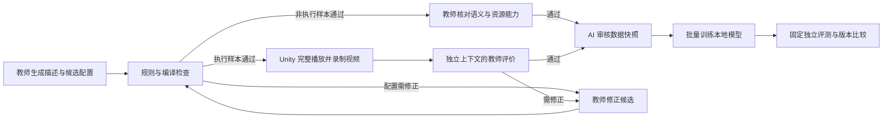

# Yukikaze 动作模型：精简接入方案

更新：2026-11-17。本文为当前主入口，旧方案不再作为接入任务清单。用户已确定以大模型教师生成数据、蒸馏到本地模型为主；目前没有人工数据，人工标注不作为启动和训练的前置条件。

## 一条主线

运行时：上游 AI 给动作描述 → 本地 MiniRBT 预测 action-config.v0.2 → Unity 编译并驱动 Yukikaze。

训练采用教师输出蒸馏：大模型直接生成动作描述和候选配置，经确定性检查及独立视频评价后，用实际通过的配置监督本地 MiniRBT。冷启动不依赖学生先生成正确动作。

AI 审核通过即可进入对应训练池，无需人工 keep。用户验收保留为可选抽查和版本确认入口，不阻塞无人工数据的采数与实验训练。视频评价反映教师判断，不应表述为已经证明符合人的审美。

学生有一定能力后，再加入“学生预测 → 教师发现错误并修正 → 重播审核”的难例采集支路。每轮仍保留教师直接生成的覆盖样本，避免语料范围被学生已有能力限制。第一版采用监督训练，不依赖强化学习或奖励模型。

## 教师数据的质量与评估

- 生成与评审分开调用。评审使用独立上下文，依据原始请求、资源能力和实际视频／参数轨迹判断，不采用生成器自己的解释作为正确证据；有条件时用不同模型交叉抽查。同模型分次调用仍可能有共同偏差。
- JSON、资源、动作数、并行冲突、明确数字和逐次关系由程序检查；视觉教师评价语义表现与自然度。不能为了通过编译静默换动作、改次数或时长；修正必须形成新候选并重播。技术失败保留失败状态，不能当成 none 或 unsupported 的语义标签。
- 无视频证据的历史 LLM 数据可在严格校验、去泄漏后作为单独标记的冷启动合成池。新闭环的执行样本只有经回放评价才进入 AI 视觉审核池；非执行样本依据语义及能力审核，不要求空视频。两种来源的数量与训练用途分别记录，不虚构历史审核。
- 在扩写前固定语义族的训练／验证／测试归属；同文、改写、源候选及参数变体不得跨切分。固定验收集不得回流训练，教师生成的验收集应标明来源与评审方式。
- 覆盖 execute、none、unsupported、ambiguous 和否定、顺序、并行、次数、逐次快慢／轻重；动作指令与角色台词使用明确的任务／输入角色信息，不能无区分地混入同一标注规则。
- 选模比较实际预测资源下的动作结构、各类误执行、精确数字／相对关系和视频表现。教师条件下的验证损失、配置格式通过率不能独自作为启用依据。

## 当前结构

| 职责 | 入口 | 状态 |
| --- | --- | --- |
| 本地预测与训练 | action_config_schema.py、train_action_config.py、server.py 的 /configure | 已实现参数头及试验权重 |
| 动作执行 | ActionConfigCompiler → ActionContract / ActionPlayer / Live2DActionAdapter | 已实现 |
| 预览、录制、数据 | PreviewSession、ReviewStore、review_evidence.py | 30fps 固定步长完整录制、参数轨迹与哈希证据；AI 证据校验/冻结已实现，人工评价可选 |
| 用户验收 | Unity：Tools > PetLive2d > 动作模型 > 用户验收 | 默认本地 v0.2，附加手工 v0.2 配置 |
| 模型测试 | retrain_and_eval.py evaluate；model_test.py 旧诊断兼容；Unity 编译检查 | 实际预测与技术错误分别统计，不自动晋级 |
| 大模型老师 | 拟新增 TeacherClient | 自动生成、视频评分、修正 API 尚未接入 |
| 一轮训练调度 | 拟新增 TrainingRoundRunner | 自动闭环尚未实现 |

旧 /plan、离散训练脚本和历史数据保留兼容；新训练及日常界面使用 v0.2。原生 v0.1 关键帧协议仍是播放器依赖，不能和旧测试一起删除。

## 下一步接入

**TeacherClient** 负责直接生成描述与候选配置、在独立评审调用中观看原句对应的视频、返回语义评价／自然度／问题和可选修正配置。教师修正首先是候选，必须再次编译、播放和评价才可进入审核池。none / unsupported / ambiguous 按原句与资源能力评价，不制作空视频。

**TrainingRoundRunner** 串起教师生成配置 → 编译播放录制 → 独立教师评价 → AI 合格入库或有限修正 → 数据快照 → 批量训练；学生推理作为后续难例支路。2026-11-17 已修复静默替换资源、短 hold 吞并、录像完成证据和训练随机切分入口；历史脏标签仍需真实核对，不能因代码修复而自动批准旧语料。

- 等完整播放结束且视频编码器关闭后送评，不能凭文件存在或录制开始时的 meta.json 判断完成。
- 编译、录制和 API 失败单独记录为技术失败，不自动成为正确标签。
- 每条描述设置修正上限、整轮设置预算；停止后保留进度，不提交未完成记录。
- 后续训练界面只需“开始一轮 / 停止 / 查看结果”，用户验收窗口保持独立。

## 数据与版本

复用候选和评价事件，教师接入时补充 reviewer_type、生成／评审模型与 prompt/rubric 版本、审核状态、配置／视频哈希、资源／编译器绑定和父候选关系。AI 评价不得写成 human_reviewed_candidate，AI 合格数据也不要求人工 keep。

ReviewStore 保留人工验收路径；AI 记录通过 review_evidence.py 验证并冻结到显式新目录，不复用人工 keep。retrain_and_eval.py 的 prepare/validate/train/evaluate 已接入，训练只接受冻结 manifest。尚未生成真实 AI accepted 池，教师 API 与自动轮次调度未接通。现有 llm_v02_corpus.jsonl 是待清洗合成池，不能称为视觉确认集。

训练输出新的实验目录，保存数据哈希、完整训练配置与切分清单；通过固定模型评测并完成版本比较后再选择启用，保留上一版。人工抽查可补充偏好评价，但没有人工数据不阻止实验训练。当前测试数据存在同文跨切分问题，不能用现有留出分数直接宣称独立泛化。

## 此前精简记录

- 删除安装期编码探针、旧 Natori 演示及旧 v0.1 验证脚本。
- 三份 Python 冒烟测试合并为一个加载现有权重的模型测试，取消测试时临时训练。
- 用户验收保留文本生成、预览录制、语义／自然度评价、通过／未通过／跳过、历史回放及 v0.2 导出。
- 移除旧种子模式、无效参数变体和确定性原句重抽；调试详情折叠。
- 保留模型权重、语料、视频及播放器。本轮不训练、不切换权重；教师 API 仍是下一项工作。

操作见 [训练与验收](D:/UnityProjects/Pet/PetLive2d/Docs/ActionEncoderTraining.md)，字段见 [输出协议](D:/UnityProjects/Pet/PetLive2d/Docs/ActionLanguage/action-config-v0.2.md)，交接见 [接手说明](D:/UnityProjects/Pet/PetLive2d/Docs/ActionLanguage/LLM_Training_Handoff_v0.2.md)。
